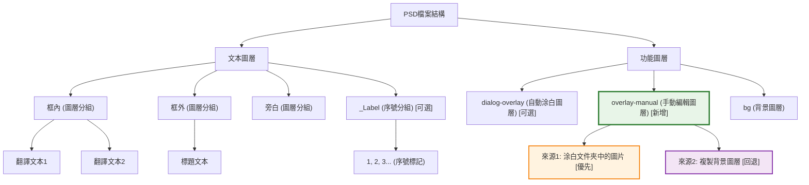

# LabelPlus PS-Script


## 🆕 新增功能：涂白文件夾 (overlay-manual)

### 功能特點
- **智能圖層管理**：新增 `overlay-manual` 圖層，用於手動編輯和背景處理
- **涂白文件夾支援**：可指定專門存放預處理圖片的文件夾
- **智能文件匹配**：支援不同後綴名匹配（如 `page01.png` 可匹配 `page01.jpg`）
- **自動回退機制**：找不到涂白圖片時自動使用背景圖層內容

### 使用方式
1. 在UI的"輸入"面板中設定**涂白文件夾**路徑（可選）
2. 在涂白文件夾中放置與原圖同名的預處理圖片
3. 執行導入，系統會自動使用涂白圖片作為 `overlay-manual` 圖層

### 適用場景
- 複雜背景需要手動預處理
- 自動涂白效果不理想時的補充方案
- 批量處理已預先涂白的圖片
- 對背景處理品質有特殊要求的專業翻譯

### 圖層結構



---

## 概述

### 直接導入已有 PSD（與圖源模式互斥）

在「輸入」面板填寫 **PSD導入路徑**，即可直接以已有 PSD 的副本添加翻譯文字。

1. 選擇翻譯文本和 PSD 文件夾。文件按主檔名匹配，例如文本中的 `001.png` 對應 `001.psd`；只匹配所選文件夾，不搜尋子文件夾。
2. 點擊「檢查匹配結果」，並選擇需要導入的圖片和翻譯分組。
3. 選擇與 PSD 來源不同的輸出目錄，輸出類型選 PSD，執行導入。

填寫 PSD 路徑後，圖源、涂白文件夾、按順序匹配、替換後綴、模板和自動涂白設定會停用；清空 PSD 路徑即可恢復原流程。

PSD 模式複製整份文檔，保留原圖層、分組及蒙版，並在原內容上方建立翻譯文字。輸出分辨率由 PPI 設定控制；取消勾選時保留原 PSD 分辨率。不新增 `bg`、`overlay-manual` 或 `dialog-overlay`；原 PSD 中已有的同名圖層會保留。原始 PSD 不會被保存修改。若原 PSD 已在 Photoshop 打開，也不會將其關閉。

### 共用的輸出 PPI 與文字抗鋸齒設定

- **設定輸出 PPI**：位於「輸出」面板，預設勾選、數值為 **72**。可改成其他正整數；取消勾選時，PSD 模式保留原 PSD 分辨率，圖源模式沿用圖源分辨率。兩種模式都在底圖裝配完成後、添加譯文之前套用設定，不重新採樣、不改變畫布像素尺寸。原有強制 72 PPI 的處理已移除。
- **消除鋸齒**：位於「樣式」面板，可選無、銳利、犀利、渾厚、平滑。預設不勾選，下拉選項預設平滑；勾選後只覆寫新導入譯文的抗鋸齒方式，保留原 PSD 已有文字的抗鋸齒設定。
- 兩項都記住啟用狀態及上次選擇。舊設定檔缺少 PPI 欄位時，使用預設的 72 PPI。字號維持以 pt 設定，因此改變 PPI 會改變相同指定字號對應的像素大小。

LabelPlus是一个用于图片翻译的工具包，本工程是其中的Photoshop文本导入工具，它读入翻译文本，并将文本逐条添加到PSD档中。

脚本用到的开源项目：
* [xtools(BSD license)](http://ps-scripts.sourceforge.net/xtools.html)中部分工具函数及UI框架
* [JSON Action Manager](http://www.tonton-pixel.com/json-photoshop-scripting/json-action-manager/index.html)中的JSON解析库

功能一览：

* 解析LabelPlus文本 创建对应文本图层
* 允许选择性导入部分文件、分组
* 允许更换图源：可使用不同尺寸、可根据顺序自动匹配文件名（图片顺序、数量必须相同）、可替换图源后缀名
* **🆕 涂白文件夹支援**：可指定涂白文件夹，自動載入預處理圖片到overlay-manual圖層
* **🆕 智能文件匹配**：支援不同後綴名的文件匹配（如.png匹配.jpg）
* 自定义自动替换文本规则（如自动将`！？`替换为`!?`）
* 格式设置：字体、字号、行距、文本方向
* 可设置自定义动作：每导入一段文字后，执行动作；打开、关闭文档时执行动作
* 根据标号位置自动涂白（实验功能）

## 开发方法

### requirement
* typescript
* python

```
$ sudo apt install python nodejs
$ sudo npm install -g typescript yarn
$ npm config set registry https://registry.npmmirror.com
$ yarn config set registry https://registry.npmmirror.com
```

### build

```
$ cd PS-Script
$ yarn install
$ ./build.sh
```

建置完成後，會在 `build/` 目錄生成 `LabelPlus_Ps_Script_ZS.jsx` 腳本文件，可直接在 Photoshop 中使用。

PSD 導入邏輯的模擬檢查（不啟動 Photoshop）：

```sh
node node_modules/typescript/bin/tsc -p . --outFile build/app.js
node tests/psd_import.test.js
```
